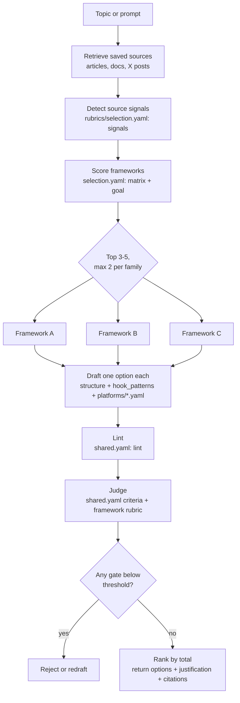

# Sakamoto post frameworks

This folder holds data for Sakamoto's post engine: writing frameworks, the rubrics used to score drafts, notes on
each platform, and hook patterns. The engine treats all of it as data. Adding or changing a framework means editing
YAML, not code.

Every example is a real post that was fetched (X API, or a public LinkedIn or essay page), quoted verbatim. A trim
is marked with `...` and a thread boundary with `[next post]`. Claims about platforms carry a `confidence`
(`high` = read in code or an official statement; `medium` = a named practitioner or study; `low` = unverified,
anecdotal, or contradicted by code) plus `source_refs` into `sources.yaml`.

## Engine flow



1. **Retrieve** the saved sources for the topic.
2. **Detect signals** in those sources (`rubrics/selection.yaml` → `signals`: e.g. `outcome_with_numbers`, `breaking_news`).
3. **Score each framework** with the generated `matrix`. The score is the sum of matched signal weights, plus goal fit (reach, trust or convert), minus `avoid_when` penalties.
4. **Pick 3-5 candidates**, with at most 2 from the same `family`. Use `comparisons` (and each framework's `better_than`) to break ties and to write the justification.
5. **Draft** one option per framework, following its `structure`, a `hook_patterns` template, and `platforms/<platform>.yaml` (length, links, fold).
6. **Score** the draft. Run the `lint` rules first. Then score every `rubrics/shared.yaml` criterion and the framework's own `rubric.criteria` on a 1-5 scale. If any `gate: true` criterion falls below its `pass_threshold`, reject the draft (this covers grounding in sources and AI-tell phrasing).
7. **Return** the ranked options. Each one comes with its framework, the reason it was picked, per-criterion reasons, and citations to saved sources.

## Layout

```
README.md            this file
schema.json          JSON Schema (draft 2020-12): root = framework; $defs for every other file
short-form/*.yaml    frameworks for single posts (≤ ~2,500 chars)
long-form/*.yaml     threads, long posts, articles
rubrics/shared.yaml  criteria every draft is scored on + lint rules
rubrics/selection.yaml  signals, generated signal→framework matrix, comparisons
platforms/x.yaml     X: length, formatting, links, media, timing, cadence, algorithm weights (from code)
platforms/linkedin.yaml  LinkedIn: same sections, practitioner-reported
hooks/hook-patterns.yaml  opening-line patterns with real examples; used_by is generated
sources.yaml         every cited source: author, Europe/Lisbon date, URL, what it contributed
tools/validate.py    parse + schema + cross-reference checks
```

## Framework schema (summary)

| field | meaning |
|---|---|
| `id`, `name`, `form`, `family` | slug equal to the file name; `short`/`long`; one of proof, teach, opinion, story, news, curation, conversation, remix |
| `summary` | one paragraph, plain words |
| `when_to_use.source_signals[]` | `{signal, weight 1-3, note}`. A weight of 3 means the framework barely works without that signal |
| `when_to_use.goals` | `{reach, trust, convert}` fit, each 0-3 |
| `avoid_when[]` | `{condition, signal?, missing_signal?}`. The optional signals let the engine apply penalties automatically |
| `better_than[]` | `{framework, when}`: when to pick this framework over another |
| `structure[]` | `{section, purpose, length, optional}` in order |
| `length` | `{unit: characters/words/posts, min, max, note}` |
| `hook_patterns[]` | 2-4 `{pattern, template}`. `pattern` is an id in `hooks/hook-patterns.yaml` |
| `rubric` | `inherits: shared` plus at least 2 criteria `{id, description, weight, anchors{1,3,5}, pass_threshold, gate?, checks?}` |
| `examples[]` | `{author, url, date (Europe/Lisbon), platform, kind, fit, excerpt, text, annotation, caveat?, metrics_at_fetch?, source_ref}` |
| `needs_examples` | `true` when the framework has fewer than 2 real examples (`fit: exact` or `partial`). A `template` example is the author's own recipe and does not count |
| `platform_notes` | `{x: [...], linkedin: [...]}` |
| `source_refs[]` | ids in `sources.yaml` (`x-<post id>`, `web-...`, `code-...`) |

The other files validate against `schema.json#/$defs/<name>`: `hooks_file`, `shared_rubric_file`,
`selection_file`, `platform_file` (every claim is `{claim, confidence, source_refs, note?}`), and `sources_file`.

## How to add a framework

1. Copy a similar file in `short-form/` or `long-form/`. Rename it, and set `id` to the new file name.
2. Fill in `when_to_use` using only the signal ids listed in `schema.json#/$defs/signal`. To add a new signal, add it
   to that enum and to `rubrics/selection.yaml` → `signals` with a `detect` hint.
3. Add 2-3 real examples. Each must be a post you fetched, quoted verbatim, with trims marked `...`. Add the post to
   `sources.yaml`. If you can't find two, set `needs_examples: true` and explain why in `needs_examples_note`.
4. Reference existing hook patterns, or add a new one to `hooks/hook-patterns.yaml` with at least one real example.
5. Add a row to `rubrics/selection.yaml` → `matrix` for the new id, copying `signals` and `goals` exactly. Add
   comparisons if the new framework competes with an existing one.
6. Run `python tools/validate.py`. It needs `pyyaml` and `jsonschema`. When the fetched raw data is next to the
   library, pass `--raw` so each example is also checked to be verbatim.

## Known limits

- The X weights are code defaults from `xai-org/x-algorithm` (commit 021afa44). Production may override them at runtime, and
  they multiply *predicted* probabilities, not raw counts.
- LinkedIn's ranking code is not public. Every LinkedIn algorithm note is practitioner-reported and marked low or medium confidence.
- Length limits (25,000-character X Premium posts, ~100k-character Articles, LinkedIn's ~140/210-character fold) come
  from third-party summaries.
- Some creator material was image or video only and could not be quoted, so it is not used as an example.
